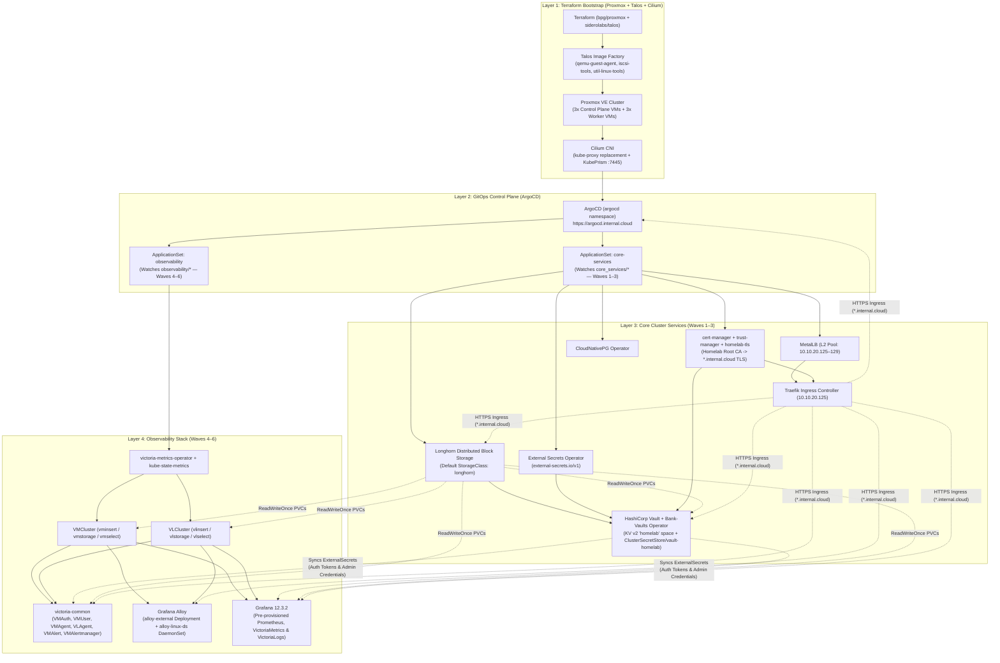
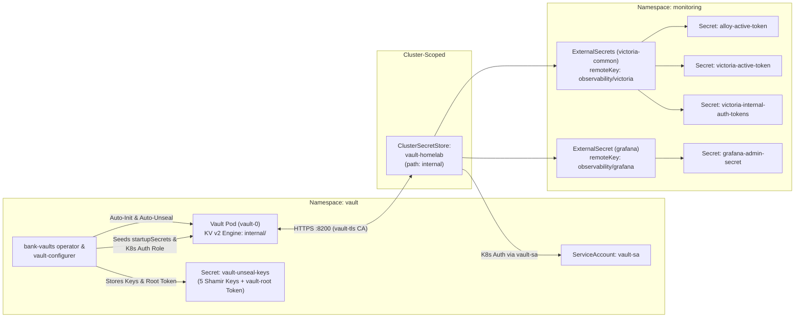
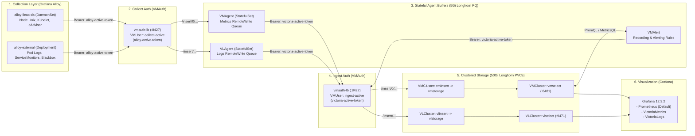

# `infra_talos` — Zero-Touch Talos Linux + Proxmox + GitOps Stack

This repository provisions an immutable, API-driven **Talos Linux Kubernetes cluster** on **Proxmox VE** using **Terraform** (eliminating Packer and Ansible), installs **Cilium CNI**, bootstraps **ArgoCD**, and manages **Core Cluster Services** (including **HashiCorp Vault** & **External Secrets Operator**) and a **VictoriaMetrics + VictoriaLogs + Grafana Alloy + Grafana Observability Stack** via Sync-Wave ordered GitOps.

---

## End-to-End Architecture & Component Wiring



---

## Architecture Layers & Sync Waves

### 1. Layer 1: Infrastructure & Cluster Bootstrap (`terraform/`)
* **Talos Image Factory (`talos-image.tf`)**: Dynamically generates a Talos schematic containing `siderolabs/qemu-guest-agent` (Proxmox IP reporting & graceful shutdown) and `siderolabs/iscsi-tools` + `siderolabs/util-linux-tools` (required by Longhorn iSCSI volumes), then downloads the ISO directly into Proxmox storage.
* **Proxmox VM Provisioning (`vms.tf`)**: Uses `bpg/proxmox` to create Control Plane (`k8s-cp-1..3`) and Worker (`k8s-worker-1..3`) VMs with per-node CPU/RAM/Disk sizing, Proxmox UI tags (`terraform`, `talos`, `k8s`, `controlplane`/`worker`), and Cloud-Init static IP configuration.
* **Talos Cluster Bootstrap (`talos-cluster.tf`)**: Generates Talos machine secrets and configs, applies `templates/controlplane-patch.yaml.tftpl` and `templates/worker-patch.yaml.tftpl` (configuring `/var/lib/longhorn` kubelet bind mounts on workers), installs Talos to `/dev/sda`, bootstraps `etcd`, and outputs `terraform/generated/kubeconfig` and `terraform/generated/talosconfig`.
* **CNI Layer (`cni.tf`)**: Installs **Cilium** via Helm with `kube-proxy` replacement, Talos KubePrism (`localhost:7445`) API server load balancing, and Hubble UI.

### 2. Layer 2: ArgoCD Bootstrap & ApplicationSets (`terraform/argocd.tf` & `gitops/`)
* **ArgoCD Helm Deployment (`argocd.tf`)**: Deploys ArgoCD into the `argocd` namespace once Cilium is ready, exposes it via Traefik (`https://argocd.internal.cloud`), and exports the initial admin password via Terraform outputs.
* **AppProjects (`gitops/projects/app-projects.yaml.tftpl`)**: Creates `core-services`, `observability`, and `workloads` projects at sync-wave `-10`.
* **ApplicationSets (`gitops/appsets/`)**: Uses Git directory generators (`core_services/*` and `observability/*`) to automatically discover and deploy charts in ordered Sync Waves (`Wave 1` through `Wave 6`) while applying Talos `PodSecurity` (`privileged`) namespace labels.

### 3. Layer 3: Core Cluster Services (`core_services/`)
| Sync Wave | Component | Namespace | Role & Wiring |
| :---: | :--- | :--- | :--- |
| **Wave 1** | `cert-manager` (`v1.20.1`) | `cert-manager` | Issues certificates and seeds the `homelab-ca-secret` Root CA. |
| **Wave 1** | `metallb` (`0.15.2`) | `metallb-system` | Bare-metal LoadBalancer controller & L2 ARP speaker. |
| **Wave 1** | `metrics-server` (`3.13.0`) | `kube-system` | Kubernetes resource metrics API (`kubectl top`). |
| **Wave 2** | `homelab-tls` (`0.1.0`) | `cert-manager` | Creates `ClusterIssuer/homelab-ca-issuer` and wildcard certificates (`wildcard-homelab-secret` for `*.internal.cloud`) across namespaces (`traefik`, `monitoring`, `vault`). |
| **Wave 2** | `trust-manager` (`v0.22.0`) | `cert-manager` | Distributes the Homelab Root CA trust bundle (`Bundle/homelab-ca-bundle`) across namespaces. |
| **Wave 2** | `metallb-custom-ip-pool` | `metallb-system` | Provisions `IPAddressPool` (`10.10.20.125-10.10.20.129`) and `L2Advertisement`. |
| **Wave 2** | `longhorn` (`1.11.1`) | `longhorn-system` | Distributed block storage (`StorageClass: longhorn`, 2 replicas, `/var/lib/longhorn`). |
| **Wave 2** | `cnpg-operator` (`0.23.2`) | `cnpg-system` | CloudNativePG operator for PostgreSQL clusters. |
| **Wave 2** | `external-secrets` (`0.16.2`) | `external-secrets` | External Secrets Operator (`external-secrets.io/v1`) syncing Vault secrets into K8s `Secret`s. |
| **Wave 3** | `traefik` (`39.0.7`) | `traefik` | Ingress controller bound to MetalLB IP `10.10.20.125` with default `wildcard-homelab-secret` TLS and Syslog TCP/UDP entrypoints. |
| **Wave 3** | `vault` (`1.23.4` / `1.21.4`) | `vault` | Bank-Vaults operator + HashiCorp Vault (`2Gi` Longhorn PVC), auto-unsealed via K8s `Secret/vault-unseal-keys`, exposing the `homelab` KV v2 space via `ClusterSecretStore/vault-homelab`. |

### 4. Layer 4: Observability Stack (`observability/`)
| Sync Wave | Component | Namespace | Role & Wiring |
| :---: | :--- | :--- | :--- |
| **Wave 4** | `victoria-metrics-operator` (`0.67.2`) | `monitoring` | Manages `VMCluster`, `VLCluster`, `VMAgent`, `VLAgent`, `VMAuth`, `VMUser`, `VMAlert`, and installs Prometheus Operator CRDs (`ServiceMonitor`, `PodMonitor`). |
| **Wave 4** | `kube-state-metrics` (`8.5.0`) | `monitoring` | Exposes Kubernetes object state metrics via `ServiceMonitor`. |
| **Wave 5** | `victoria-metrics` (`0.1.0`) | `monitoring` | Deploys `VMCluster/vmcluster` (`vminsert`, `vmselect`, and `vmstorage` backed by `50Gi` Longhorn PVC, `30d` retention). |
| **Wave 5** | `victoria-logs` (`0.1.0`) | `monitoring` | Deploys `VLCluster/vlcluster` (`vlinsert`, `vlselect`, and `vlstorage` backed by `50Gi` Longhorn PVC, `30d` retention). |
| **Wave 6** | `victoria-common` (`0.1.0`) | `monitoring` | Deploys `VMAuth` (`vmauth-lb`), `VMUser` token rules, stateful `VMAgent` & `VLAgent` (with `5Gi` Longhorn persistent queues), `VMAlert`, `VMAlertmanager`, `VMRule` alerts, and `ExternalSecret`s from `vault-homelab`. |
| **Wave 6** | `grafana-alloy` (`1.6.2`) | `monitoring` | Clustered `alloy-external` Deployment collecting Pod logs, `ServiceMonitor`/`PodMonitor` targets, Blackbox probes, and external push receivers (`alloy-logs` / `alloy-metrics`). |
| **Wave 6** | `alloy-daemonset` (`1.6.2`) | `monitoring` | Node-level `alloy-linux-ds` DaemonSet scraping host Unix metrics (`node_exporter` equivalent) and Kubelet/cAdvisor metrics. |
| **Wave 6** | `grafana` (`12.3.2`) | `monitoring` | Grafana UI (`10Gi` Longhorn PVC) with `victoriametrics-metrics-datasource` and `victoriametrics-logs-datasource` plugins, pre-provisioned datasources, and admin credentials synced from `vault-homelab`. |

### 5. Layer 5: Production Workloads, HA Vector DB & Local AI (`workloads/` — Wave 7)
| Sync Wave | Component | Namespace | Role & Wiring |
| :---: | :--- | :--- | :--- |
| **Wave 7** | `postgres-cluster` (`0.1.0`) | `postgres-cluster` | 2-node HA **CloudNativePG** PostgreSQL 16 cluster (`StorageClass: longhorn`) with `pgvector` extension enabled (`CREATE EXTENSION IF NOT EXISTS vector;`), database credentials synced from Vault (`homelab/workloads/postgres`) via `ExternalSecret`, and `PodMonitor` scraped by Grafana Alloy. |
| **Wave 7** | `llm-stack` (`0.1.0`) | `llm-stack` | Local AI & LLM Stack: `nvidia-device-plugin` DaemonSet (`RuntimeClass: nvidia`), Multi-GPU **Ollama** StatefulSet (`50Gi` Longhorn PVC, auto-pulling `nomic-embed-text`, `llama3.2:3b`, `qwen2.5-coder:3b`, `qwen2.5-coder:7b`), and **Open WebUI** (`https://chat.internal.cloud`) backed by PostgreSQL `pgvector` & Vault `ExternalSecret`. |

---

## Single-File Platform Customization (`terraform.tfvars`)

The entire stack (Layers 1–5) is parameterized end-to-end from **`terraform/terraform.tfvars`**. Terraform dynamically injects your domain, IP pools, TLS mode, and initial Vault secrets into the ArgoCD `ApplicationSet` Helm overrides—no manual editing of `values.yaml` files across the repository is required:

| Variable | Default | Description |
| :--- | :--- | :--- |
| `base_domain` | `"internal.cloud"` | Base domain propagated to all Ingresses and wildcard TLS certificates (`*.<base_domain>`). |
| `metallb_ip_pool_start` | `"10.10.20.125"` | First IPv4 address in the MetalLB L2 LoadBalancer pool. |
| `metallb_ip_pool_end` | `"10.10.20.129"` | Last IPv4 address in the MetalLB L2 LoadBalancer pool. |
| `traefik_lb_ip` | `""` *(uses start IP)* | Static LoadBalancer IP bound to the Traefik Ingress Controller. |
| `tls_mode` | `"internal-ca"` | `"internal-ca"` (cluster Root CA) or `"letsencrypt"` (ACME DNS-01 wildcard via Cloudflare). |
| `acme_cloudflare_api_token` | `""` | Cloudflare API token (`Zone:DNS:Edit`) when `tls_mode = "letsencrypt"`. |
| `longhorn_s3_backup_enabled` | `false` | Enables Longhorn S3 backup target, Vault S3 secret sync, and daily `RecurringJob` volume backups. |
| `enable_workloads_appset` | `false` | Deploys Wave 7 workloads (`workloads/postgres-cluster` HA PostgreSQL cluster). |

---

## How Secrets & Observability Pipelines Are Wired

### 1. Secret Management Flow (Vault + External Secrets Operator)

All infrastructure secrets live in the in-cluster **HashiCorp Vault** instance under the dedicated **`internal`** KV v2 secrets engine (`path: internal`), exposed cluster-wide via `ClusterSecretStore/vault-homelab`:



* **Zero Manual Unsealing**: `bank-vaults` initializes Vault on first boot, stores the unseal keys and root token in `Secret/vault-unseal-keys` (`vault` namespace), automatically unseals `vault-0` across restarts, and runs `vault-configurer` to apply policies, Kubernetes Auth roles, and `startupSecrets`.
* **Seeded `internal` Paths (`core_services/vault/values.yaml`)**:
  * `internal/data/observability/victoria` (`remoteRef.key: observability/victoria`):
    * `alloy_active_token`: Bearer token used by Grafana Alloy to push to `VMAuth` (`collect-active` user).
    * `victoria_active_token`: Bearer token used by `VMAgent`, `VLAgent`, and `VMAlert` to push to `VMAuth` (`ingest-active` user).
  * `internal/data/observability/grafana` (`remoteRef.key: observability/grafana`):
    * `admin-user` & `admin-password`: Synced into `Secret/grafana-admin-secret` and mounted by Grafana.
* **Adding New Secrets to Any Namespace**:
  1. Write a secret into the `internal/` space in Vault UI (`https://vault.internal.cloud`) or add it under `vault.startupSecrets` in `core_services/vault/values.yaml`.
  2. Create an `ExternalSecret` (`apiVersion: external-secrets.io/v1`) referencing `secretStoreRef.name: vault-homelab` (`kind: ClusterSecretStore`).

---

### 2. Two-Tier Observability Pipeline (Alloy -> VMAuth -> Agents -> Storage -> Grafana)

Metrics and logs flow through a two-tier buffered pipeline protected by `VMAuth` bearer tokens so that transient storage restarts never drop telemetry:



---

### 3. TLS & Ingress Routing (`*.internal.cloud`)

1. **MetalLB** assigns `10.10.20.125` from `10.10.20.125-10.10.20.129` to the `traefik` `LoadBalancer` Service.
2. **`cert-manager`** + **`homelab-tls`** sign a wildcard TLS certificate (`*.internal.cloud` + `internal.cloud`) using the Homelab Root CA (`ClusterIssuer/homelab-ca-issuer`) and store it as `Secret/wildcard-homelab-secret` in `traefik`, `monitoring`, and `vault`.
3. **Traefik** uses `wildcard-homelab-secret` as its default `TLSStore` certificate and automatically redirects HTTP (`:80`) to HTTPS (`:443`).
4. **Browser Trust**: Terraform automatically exports the Root CA certificate to `terraform/generated/homelab-root-ca.crt` so you can import it into your browser's **Trusted Root Certification Authorities** (`Authorities` store).

| Service | FQDN | Backing Service / Notes |
| :--- | :--- | :--- |
| **ArgoCD UI** | `https://argocd.internal.cloud` | `argocd-server` (`argocd` namespace) |
| **Vault UI & API** | `https://vault.internal.cloud` | `vault:8200` (`vault` namespace, TLS passthrough via `ServersTransport`) |
| **Grafana UI** | `https://grafana.internal.cloud` | `grafana:80` (`monitoring` namespace) |
| **Longhorn UI** | `https://longhorn.internal.cloud` | `longhorn-frontend:80` (`longhorn-system` namespace) |
| **VictoriaMetrics (`VMAuth`)** | `https://vm.internal.cloud` | Redirects `/` to `/select/0/vmui/`; exposes `/vmalert/` and `/vmalertmanager/` |
| **VictoriaLogs (`VMAuth`)** | `https://vl.internal.cloud` | Redirects `/` to `/select/vmui/` |
| **Alloy Logs Push** | `https://alloy-logs.internal.cloud` | External Loki push endpoint (`/loki/api/v1/push`) |
| **Alloy Metrics Push** | `https://alloy-metrics.internal.cloud` | External Prometheus remote-write receiver (`/api/v1/write`) |

---

## Project Structure

```text
infra_talos/
├── .gitignore
├── README.md
├── core_services/                         # Layer 3: Core Cluster Services Helm Charts
│   ├── cert-manager/                      # Wave 1: Cert-Manager + Homelab Root CA Secret
│   ├── metallb/                           # Wave 1: MetalLB Controller & Speaker
│   ├── metrics-server/                    # Wave 1: Kubernetes Metrics Server
│   ├── homelab-tls/                       # Wave 2: ClusterIssuer & *.internal.cloud Certificates
│   ├── trust-manager/                     # Wave 2: Cluster-wide Homelab CA Bundle distribution
│   ├── metallb-custom-ip-pool/            # Wave 2: MetalLB L2 Pool (10.10.20.125-10.10.20.129)
│   ├── longhorn/                          # Wave 2: Longhorn Distributed Block Storage
│   ├── cnpg-operator/                     # Wave 2: CloudNativePG Operator
│   ├── external-secrets/                  # Wave 2: External Secrets Operator (v0.16.2)
│   ├── traefik/                           # Wave 3: Traefik Ingress Controller (10.10.20.125)
│   └── vault/                             # Wave 3: Bank-Vaults Operator + HashiCorp Vault ('homelab' KV v2)
├── observability/                         # Layer 4: VictoriaMetrics + Alloy + Grafana Stack
│   ├── victoria-metrics-operator/         # Wave 4: VictoriaMetrics Operator + Prometheus CRDs
│   ├── kube-state-metrics/                # Wave 4: Kube-State-Metrics + ServiceMonitor
│   ├── victoria-metrics/                  # Wave 5: VMCluster (vmstorage, vmselect, vminsert)
│   ├── victoria-logs/                     # Wave 5: VLCluster (vlstorage, vlselect, vlinsert)
│   ├── victoria-common/                   # Wave 6: VMAuth, VMUser, VMAgent, VLAgent, VMAlert, ExternalSecrets
│   ├── grafana-alloy/                     # Wave 6: Clustered Alloy (Pod logs, ServiceMonitors, Blackbox)
│   ├── alloy-daemonset/                   # Wave 6: Node DaemonSet Alloy (Unix exporter, Kubelet/cAdvisor)
│   └── grafana/                           # Wave 6: Grafana UI + Datasources + ExternalSecret
├── gitops/
│   ├── bootstrap/                         # Local Helm chart for AppProjects & ApplicationSets
│   ├── projects/
│   │   └── app-projects.yaml.tftpl        # ArgoCD AppProjects (core-services, observability, workloads)
│   └── appsets/
│       ├── core-services-appset.yaml.tftpl # Sync-wave ordered Core Services ApplicationSet (Waves 1-3)
│       ├── observability-appset.yaml.tftpl # Sync-wave ordered Observability ApplicationSet (Waves 4-6)
│       └── workloads-appset.yaml.tftpl     # Optional Wave 7 Workloads ApplicationSet (HA PostgreSQL)
├── workloads/                             # Layer 5: Optional Production Workloads (Wave 7)
│   └── postgres-cluster/                  # 2-node HA CloudNativePG PostgreSQL 16 + Vault ESO + S3 Barman Backup
└── terraform/
    ├── versions.tf                        # Provider requirements (bpg/proxmox, siderolabs/talos, helm, kubernetes)
    ├── providers.tf                       # Provider configurations
    ├── variables.tf                       # Input variables, defaults, and validation rules
    ├── talos-image.tf                     # Talos Image Factory schematic & Proxmox ISO download
    ├── vms.tf                             # Proxmox VM definitions (Control Plane & Workers + Proxmox tags)
    ├── talos-cluster.tf                   # Talos machine configs, bootstrap, kubeconfig/talosconfig generation
    ├── cni.tf                             # Cilium CNI Helm release
    ├── argocd.tf                          # ArgoCD Helm release, AppProjects & ApplicationSets bootstrap
    ├── outputs.tf                         # Cluster endpoints, schematic ID, and credential paths
    ├── terraform.tfvars.example           # Reference example of all configurable variables
    └── templates/
        ├── controlplane-patch.yaml.tftpl  # Control plane machine config patch
        └── worker-patch.yaml.tftpl        # Worker machine config patch (with /var/lib/longhorn mounts)
```

---

## Quick Start & Credential Retrieval

### 1. Provision Cluster & Bootstrap GitOps

```bash
cd infra_talos/terraform

# 1. Create terraform.tfvars with your Proxmox API token secret (all other defaults live in variables.tf)
cp terraform.tfvars.example terraform.tfvars

# 2. Initialize and apply
terraform init
terraform apply

# 3. Export generated cluster credentials
export KUBECONFIG="$(pwd)/generated/kubeconfig"
export TALOSCONFIG="$(pwd)/generated/talosconfig"

kubectl get nodes -o wide
```

### 2. Retrieve Service Credentials

* **ArgoCD Admin Password** (`https://argocd.internal.cloud`, user: `admin`):
  ```bash
  cd infra_talos/terraform && terraform output -raw argocd_initial_admin_password; echo
  ```
* **Vault Root Token** (`https://vault.internal.cloud`):
  ```bash
  kubectl get secret -n vault vault-unseal-keys -o jsonpath='{.data.vault-root}' | base64 -d; echo
  ```
* **Grafana Admin Credentials** (`https://grafana.internal.cloud`, managed in Vault at `homelab/observability/grafana`):
  ```bash
  kubectl get secret -n monitoring grafana-admin-secret -o jsonpath='{.data.admin-password}' | base64 -d; echo
  ```
* **Root CA Certificate for Browser Trust** (`*.internal.cloud`):
  Import `infra_talos/terraform/generated/homelab-root-ca.crt` into your browser under **Settings $\rightarrow$ Privacy & Security $\rightarrow$ Security $\rightarrow$ Manage Certificates $\rightarrow$ Authorities $\rightarrow$ Import**.
* **All Platform Service URLs**:
  ```bash
  cd infra_talos/terraform && terraform output platform_urls
  ```

---

## Day-2 Operations & Disaster Recovery Runbook

### 1. Switching Between Internal Root CA and Let's Encrypt (Cloudflare DNS-01)
To switch all cluster ingresses (`*.<base_domain>`) from the built-in self-signed Root CA to publicly trusted Let's Encrypt wildcard certificates:
```hcl
# In terraform/terraform.tfvars:
base_domain               = "example.com"
tls_mode                  = "letsencrypt"
acme_email                = "ops@example.com"
acme_cloudflare_api_token = "your-cloudflare-dns-edit-token"
```
Run `terraform apply`. ArgoCD automatically updates `ClusterIssuer/homelab-ca-issuer` to use ACME DNS-01 and re-issues wildcard certificates across `traefik`, `monitoring`, and `vault` without downtime.

### 2. Enabling S3 Disaster Recovery Backups (Longhorn Volumes)
To automatically back up all Longhorn persistent volumes every night at 02:00 AM to AWS S3, Cloudflare R2, MinIO, or Backblaze B2:
```hcl
# In terraform/terraform.tfvars:
longhorn_s3_backup_enabled = true
longhorn_s3_backup_target  = "s3://my-cluster-backups@us-east-1/longhorn"
longhorn_s3_endpoint       = "https://<account-id>.r2.cloudflarestorage.com" # Leave empty for AWS S3
longhorn_s3_access_key     = "your-access-key-id"
longhorn_s3_secret_key     = "your-secret-access-key"
```
Run `terraform apply`. Vault seeds the credentials under `homelab/storage/longhorn-s3`, `ExternalSecret` creates `Secret/longhorn-s3-credentials` in `longhorn-system`, and Longhorn registers the `daily-s3-backup` `RecurringJob`.

#### Restoring a Volume from S3 (Single PVC or Full Cluster Rebuild)
When a new cluster is provisioned with the same `longhorn_s3_backup_target`, Longhorn automatically discovers all existing S3 backups and lists them under **Backup** in the Longhorn UI (`https://longhorn.<base_domain>`):
1. **Pause workload & delete empty PVC** (if restoring over an existing application):
   ```bash
   kubectl scale statefulset <app> -n <namespace> --replicas=0
   kubectl delete pvc <pvc-name> -n <namespace>
   ```
2. **Restore in Longhorn UI**:
   * Open `https://longhorn.<base_domain>` $\rightarrow$ **Backup** $\rightarrow$ select the backup volume $\rightarrow$ click **Restore** (check *Restore Volume Name*).
   * Go to **Volume** $\rightarrow$ select the restored volume $\rightarrow$ **Create PV/PVC** with the original `Namespace` and `PVC Name` (leave *Use Previous PVC* checked).
3. **Scale workload back up**:
   ```bash
   kubectl scale statefulset <app> -n <namespace> --replicas=1
   ```

### 3. Deploying the Turnkey HA PostgreSQL Cluster (`CloudNativePG`)
Set `enable_workloads_appset = true` in `terraform/terraform.tfvars` and run `terraform apply`. ArgoCD deploys `workloads/postgres-cluster` at Sync Wave 7:
* Provisions a 2-instance Primary/Standby PostgreSQL 16 cluster (`platform-postgres`) on Longhorn storage.
* Syncs application database credentials (`appuser`) from Vault (`homelab/workloads/postgres`) into `Secret/platform-postgres-app-creds`.
* Automatically exposes PostgreSQL metrics via `PodMonitor` to Grafana Alloy and VictoriaMetrics.

### 4. Upgrading Talos Linux & Kubernetes Versions
Update `talos_version` or `kubernetes_version` in `terraform/terraform.tfvars` and run `terraform apply` to update the machine configurations, or perform rolling node upgrades via `talosctl`:
```bash
export TALOSCONFIG="$(pwd)/generated/talosconfig"
talosctl upgrade --nodes 10.10.20.121 --image "$(terraform output -raw talos_installer_image)"
talosctl upgrade-k8s --nodes 10.10.20.120 --to 1.32.2
```
